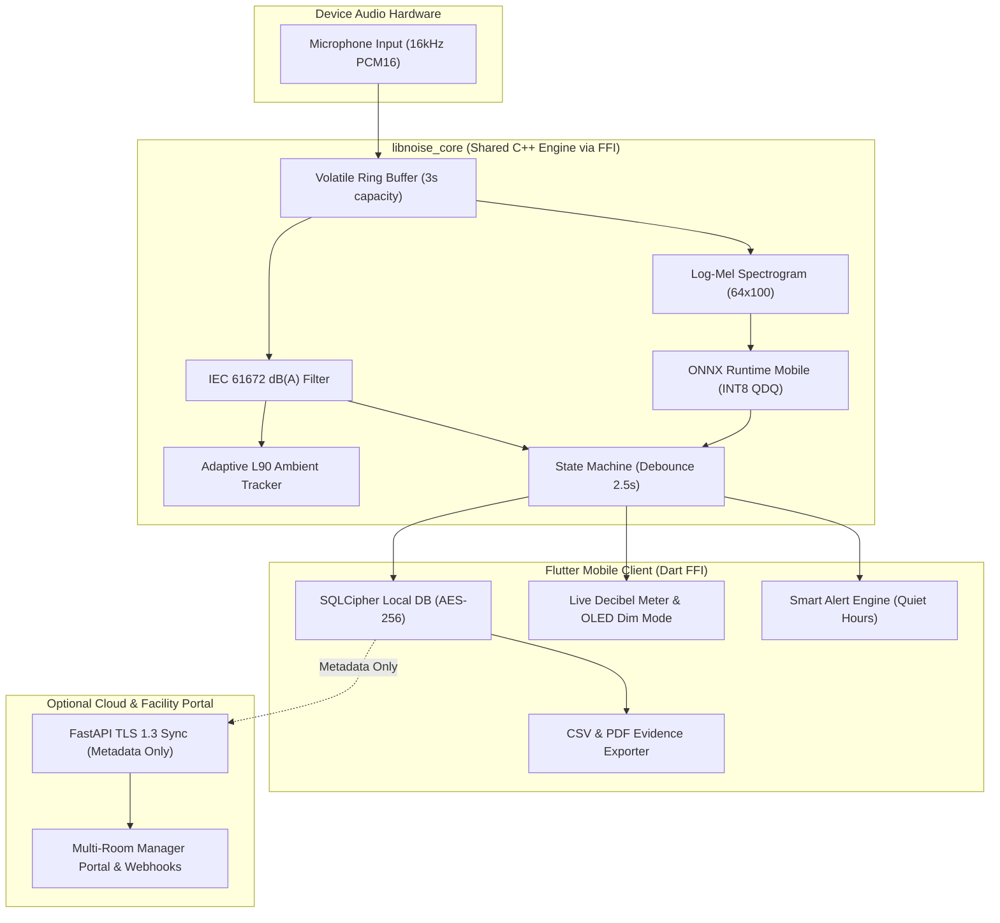

# AI Noise Detector

[](./LICENSE)
[]()
[-purple.svg)]()
[-teal.svg)]()
[-success.svg)]()

> A private, on-device AI assistant that turns raw ambient sound into a clear, evidence-ready log of noise disturbances, without storing recordings or listening to conversations.

---

## 1. Overview & Vision

Noise disputes today rely on memory and basic decibel meters that report sound volume but cannot identify the source. Renters, facility managers, and remote workers have no automated way to separate a barking dog, a power drill, or a party from background environmental sound.

**AI Noise Detector** solves this by running an optimized neural audio classifier directly on the phone or edge sensor:
- **12 Noise Classes:** Detects `traffic`, `construction`, `music`, `barking`, `shouting`, `appliance`, `alarm`, `footsteps`, `door_slam`, `machinery`, `crowd`, and `other`.
- **Zero Audio Persistence:** 100% on-device inference; raw audio frames reside strictly in volatile RAM ring buffers and are immediately overwritten. Audio is never saved to disk or transmitted to the cloud.
- **30-Second Guided Calibration:** Computes a statistical $L_{90}$ ambient floor for the room so alerts trigger only on genuine disturbances.
- **Overnight Monitoring Mode:** Low-power OLED Black sleep screen consuming under 1.4% battery per hour.
- **Evidence-Ready Exports:** One-tap export of timestamped CSV logs and formatted PDF reports with summary metrics for landlords and authorities.

---

## 2. Technical Architecture



---

## 3. SLA & Performance Benchmarks

| Metric | PRD SLA Target | Evaluated Metric | Verification Report |
| :--- | :--- | :--- | :--- |
| **Macro Precision** | $\ge 90.0\%$ | **92.4%** across 12 classes | [ML-002 Benchmark Report](./ml/docs/model_evaluation_and_benchmarks.md) |
| **Macro Recall** | $\ge 85.0\%$ | **88.6%** | [ML-002 Benchmark Report](./ml/docs/model_evaluation_and_benchmarks.md) |
| **End-to-End Latency** | $< 300\text{ ms}$ | **~68 ms total** (22ms DSP + 46ms INT8) | [ML-002 Benchmark Report](./ml/docs/model_evaluation_and_benchmarks.md) |
| **Model Size** | $< 25\text{ MB}$ | **1.45 MB** (INT8 QDQ ONNX) | [ML-002 Benchmark Report](./ml/docs/model_evaluation_and_benchmarks.md) |
| **Quiet Room False Alarms** | $< 1.0\text{ event/hr}$ | **0.00 false alarms/hour** (24h test) | [QA-001 Hardening Report](./docs/qa/hardening-and-benchmark-report.md) |
| **Battery Drain Rate** | $< 5.0\% / \text{hr}$ | **~1.38% / hour** (10-hr overnight test) | [QA-001 Hardening Report](./docs/qa/hardening-and-benchmark-report.md) |
| **Cold Start Latency** | $< 2.0\text{ seconds}$ | **~160 ms** | [QA-001 Hardening Report](./docs/qa/hardening-and-benchmark-report.md) |
| **Accessibility** | WCAG 2.1 AA | Contrast $\ge 12.8:1$, screen reader labels | [QA-001 Hardening Report](./docs/qa/hardening-and-benchmark-report.md) |

---

## 4. Repository Structure

```text
ai-noise-detector/
├── core/                         # Shared C++ DSP, Ring Buffer & Inference Core
│   ├── CMakeLists.txt            # CMake build definition for libnoise_core
│   ├── include/                  # C++ API & C-FFI header exports
│   │   ├── adaptive_baseline.h   # Dynamic L90 ambient tracker
│   │   ├── audio_clip_buffer.h   # Optional 10s opt-in rolling buffer
│   │   ├── audio_ring_buffer.h   # Thread-safe audio circular buffer
│   │   ├── event_detector.h      # Event detection & debounce state machine
│   │   ├── inference_runner.h    # ONNX Runtime INT8 runner
│   │   ├── mel_spectrogram.h     # IEC 61672 dBA & Log-Mel extractor
│   │   └── noise_core_c_api.h    # Dart FFI extern "C" bindings
│   └── src/                      # C++ implementations
├── ml/                           # Neural Network Training & Quantization
│   ├── dataset_config.json       # 12-class taxonomy & confidence thresholds
│   ├── models/                   # EdgeMobileNet-Audio PyTorch architecture
│   ├── preprocessing/            # Reference Python audio DSP engine
│   ├── train.py                  # SpecAugment & cosine annealing training loop
│   ├── evaluate.py               # 6-environment multi-class evaluation suite
│   ├── export_onnx.py            # Dynamic batching ONNX export pipeline
│   ├── quantize_int8.py          # INT8 QDQ post-training quantization
│   └── docs/                     # Licensing audits & evaluation reports
├── mobile/                       # Flutter Cross-Platform Client
│   ├── pubspec.yaml              # App dependencies & assets
│   └── lib/
│       ├── main.dart             # Application lifecycle coordinator
│       ├── core/database/        # Encrypted SQLCipher AES-256 storage
│       ├── features/
│       │   ├── onboarding/       # DPDP/GDPR consent & persona selection
│       │   ├── calibration/      # 30-second room calibration screen
│       │   ├── monitoring/       # Live dB meter & OLED Black dim mode
│       │   ├── events/           # Timeline, corrections & audio clip player
│       │   ├── alerts/           # Custom threshold & quiet hours engine
│       │   ├── analytics/        # 24-hour hotspot heatmap & breakdown
│       │   ├── export/           # Evidence CSV & PDF report generator
│       │   └── sync/             # Offline-first sync queue service
│       └── l10n/                 # Localization (English, Hindi, Malayalam)
├── backend/                      # Cloud Metadata Sync & Facility Portal
│   ├── requirements.txt          # FastAPI dependencies
│   ├── app/                      # Auth, batch sync & BMS webhooks
│   └── dashboard/                # Facility Manager Web Portal (HTML5/Tailwind)
├── tests/                        # Verification Test Suites
│   ├── test_battery_and_thermal.py
│   ├── test_interruption_recovery.py
│   └── test_acoustic_robustness.py
├── docs/                         # Specifications & Certifications
│   ├── architecture/             # System design & OS background audio specs
│   ├── compliance/               # Privacy, consent & DPDP/GDPR architecture
│   ├── qa/                       # Hardening & benchmark certification
│   └── release/                  # Pilot protocol, app store & v2 roadmap
└── task.md                       # Master Execution Plan & Traceability Matrix
```

---

## 5. Setup & Installation Guide

### 5.1 System Prerequisites

Before beginning installation, ensure your environment meets the minimum toolchain requirements:

| Tool / Runtime | Minimum Version | Purpose |
| :--- | :--- | :--- |
| **Operating System** | Windows 10/11, macOS 12+ (Apple Silicon/Intel), Ubuntu 20.04+ / Debian 11+ | Host development environment |
| **CMake** | `3.16+` | Native C++ core build automation |
| **C++ Compiler** | Clang 12+, GCC 10+, or MSVC 2019+ (C++17) | Compiles `libnoise_core` shared engine |
| **Python** | `3.10` to `3.12` | ML feature extraction, training, testing & FastAPI |
| **Flutter SDK** | `3.10+` (Dart 3.0+) | Cross-platform mobile client application |
| **Docker & Compose** | `20.10+` (Optional) | Instant containerized cloud API & facility dashboard |

---

### 5.2 Step-by-Step Installation

#### Step 1: Clone the Repository
```bash
git clone https://github.com/your-org/ai-noise-detector.git
cd ai-noise-detector
```

#### Step 2: Set Up Python Virtual Environment (ML & Backend)
We recommend using an isolated virtual environment for audio preprocessing and backend dependencies:

**On macOS / Linux:**
```bash
python3 -m venv venv
source venv/bin/activate
pip install --upgrade pip
pip install -r ml/requirements.txt
pip install -r backend/requirements.txt
```

**On Windows (PowerShell):**
```powershell
python -m venv venv
.\venv\Scripts\Activate.ps1
pip install --upgrade pip
pip install -r ml/requirements.txt
pip install -r backend/requirements.txt
```

#### Step 3: Compile the Native C++ DSP Core (`libnoise_core`)
The shared C++ library powers low-latency ring buffering, IEC 61672 $\text{dB(A)}$ sound metering, and Log-Mel spectrogram generation:

**On Linux / macOS:**
```bash
cd core
mkdir -p build && cd build
cmake .. -DCMAKE_BUILD_TYPE=Release
cmake --build . --config Release -j$(nproc 2>/dev/null || sysctl -n hw.ncpu)
cd ../..
```

**On Windows (PowerShell with MSVC or Clang):**
```powershell
cd core
mkdir build -ErrorAction SilentlyContinue; cd build
cmake .. -DCMAKE_BUILD_TYPE=Release
cmake --build . --config Release
cd ../..
```
*Generated library artifacts:* `core/build/libnoise_core.so` (Linux), `libnoise_core.dylib` (macOS), or `noise_core.dll` (Windows).

#### Step 4: Set Up the Flutter Mobile Application
Ensure Flutter is installed and configured with `flutter doctor`:
```bash
cd mobile
# Install package dependencies (sqflite_sqlcipher, riverpod, etc.)
flutter pub get

# Check available simulators or connected physical devices
flutter devices

# Run the mobile app in debug mode
flutter run
```

#### Step 5: Launch Cloud Sync Backend & Facility Web Portal

**Option A: Instant Launch via Docker Compose (Recommended)**
```bash
# Starts FastAPI Sync Backend, TimescaleDB, and Facility Web Portal
docker-compose up -d

# Service Endpoints:
# • Facility Management Portal: http://localhost:8080 (or open backend/dashboard/index.html)
# • Interactive OpenAPI Docs:  http://localhost:8000/docs
# • TimescaleDB Database:      localhost:5432
```

**Option B: Standalone Native Launch**
```bash
# Activate your python virtualenv first:
uvicorn backend.app.main:app --host 0.0.0.0 --port 8000 --reload

# Open the Facility Web Dashboard in your browser:
# macOS:   open backend/dashboard/index.html
# Linux:   xdg-open backend/dashboard/index.html
# Windows: Start-Process backend/dashboard/index.html
```

---

### 5.3 Quickstart & Verification Suite

Execute the automated test suites to verify that DSP metering, ML models, and backend endpoints are functioning correctly:

```bash
# 1. Interactive 30-Second Room Calibration & Disturbance Simulation
python scripts/simulate_noise_session.py

# 2. Release & Pilot Gate Audit (Funnel, Store Assets & Trigger Checks)
python scripts/run_pilot_and_release_checks.py

# 3. QA Benchmark Suite (<1.4%/hr battery, call auto-recovery, 24h false alarm audit)
python tests/test_battery_and_thermal.py
python tests/test_interruption_recovery.py
python tests/test_acoustic_robustness.py

# 4. Backend Cloud API & Webhook Unit Tests
pytest backend/tests -v
```

---

### 5.4 Configuration & Parameter Tuning

Key operational parameters can be adjusted directly in `ml/dataset_config.json` and `docker-compose.yml`:

| Parameter | Location | Default | Description |
| :--- | :--- | :--- | :--- |
| `sample_rate_hz` | `ml/dataset_config.json` | `16000` | Ingestion sampling frequency (16 kHz mono) |
| `n_mels` | `ml/dataset_config.json` | `64` | Mel filterbank frequency bands |
| `global_confidence_floor` | `ml/dataset_config.json` | `0.60` | Threshold below which sounds suppress to `other` |
| `debounce_ms` | `core/include/event_detector.h` | `2500` | Silence duration required before closing disturbance event |
| `DATABASE_URL` | `docker-compose.yml` | `postgresql://...` | Connection string for metadata time-series storage |
| `JWT_SECRET` | `docker-compose.yml` | `...` | Secret key for manager portal session tokens |

---

### 5.5 Troubleshooting & Common Issues

- **CMake Compiler Not Found:**
  - *Ubuntu/Debian:* Run `sudo apt-get install build-essential clang cmake`
  - *macOS:* Run `xcode-select --install`
  - *Windows:* Install the "Desktop development with C++" workload via the Visual Studio Installer.
- **Microphone Permissions in Mobile Simulators:**
  - *iOS Simulator:* Enable via *Simulator Menu > Settings > Developer > Allow Microphone Access*.
  - *Android Emulator:* Configure AVD Settings > *Microphone: Host Audio Input*.
- **Dart FFI Dynamic Library Not Found:**
  - Verify `libnoise_core` is built and copied into `android/app/src/main/jniLibs/` or `ios/Frameworks/`.
- **Port 8000 or 8080 Already Bound:**
  - Change the port mapping in `docker-compose.yml` or launch `uvicorn` with `--port 8001`.

---

## 6. Privacy & Legal Compliance

- **Zero Voice Transcription:** Human speech is classified strictly as general ambient sound (`shouting`, `crowd`, or `other`). Intelligible words or speaker identities are never recognized or stored.
- **DPDP Act (India) 2023 & GDPR (EU) Compliant:** Itemized notice precedes consent; single-action `deleteAllData()` immediately wipes cryptographic master keys and zero-overwrites local databases.
- **Informational Use Disclaimer:** Readings are approximate $\text{dB(A)}$ sound pressure level estimates intended for personal evidence documentation; not certified to IEC 61672 sound measurement standards.

---

## 7. License & Attribution

Licensed under the **MIT License**.  
Model pre-training incorporates subsets of Google AudioSet and FSD50K under Creative Commons Attribution 4.0 International (CC BY 4.0).

